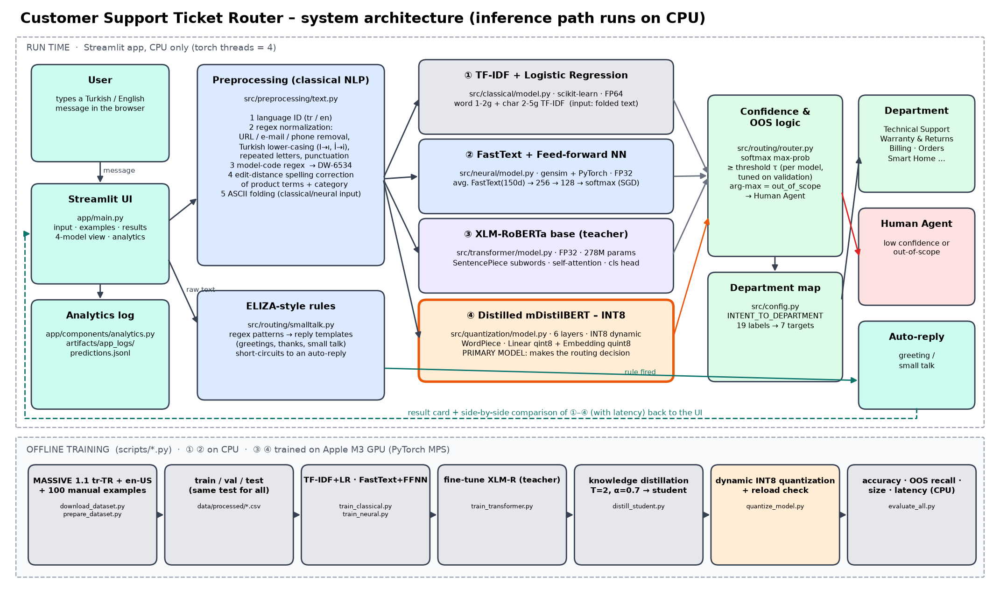

# Customer Support Ticket Router

SWE015 – Introduction to Large Language Models · Homework · **Use Case 2: Customer Support Ticket Router**

* Demo video (2 min): https://drive.google.com/file/d/1OkpE_dM0JU57XOel24jqHBzsU5b3WJq8/view?usp=sharing
* Presentation: [docs/presentation.pdf](docs/presentation.pdf)
* Trained model artifacts (Google Drive): https://drive.google.com/file/d/1uRCamfX7Ifb2V4-JrpcALzNN6wGcYMV7/view?usp=sharing

A home-appliance brand receives support messages in **Turkish and English**. This application
normalizes each message, extracts the product model code, predicts the intent with a confidence
score and routes it to the right department. Low-confidence or out-of-scope messages go to a
**human agent**; greetings and small talk get an ELIZA-style rule-based reply. Four models of
increasing sophistication are trained and compared on the same held-out test set, and the
**distilled, INT8-quantized Transformer runs inside the application** on CPU.



## Features
* Free-text input in Turkish or English, language indicator, example buttons (including
  misspelled, informal, model-code, ambiguous and out-of-scope messages), clear button.
* Regex normalization with Turkish casing rules (I→ı, İ→i), URL/e-mail/phone removal and
  squashing of repeated letters.
* Product model-code extraction (`bulaşık makinem su boşaltmıyor model DW-6534` → `DW-6534`)
  and product category detection (`dishwasher`).
* Edit-distance (Levenshtein) spelling correction of product terms (`dishwaser` → `dishwasher`,
  `bulasik` → `bulaşık`).
* Intent, department and confidence; Human Agent routing for out-of-scope or low-confidence
  messages; rule-based replies for small talk.
* Side-by-side predictions of all four models with their inference time; the INT8 model is
  highlighted and makes the routing decision.
* Analytics tab computed from the messages really processed by the app
  (`artifacts/app_logs/predictions.jsonl`), plus a benchmark tab with the measured results.

## Model ladder

| # | Model | Technique area | Code |
|---|---|---|---|
| ① | TF-IDF (word 1-2 + char 2-5 grams) + Logistic Regression | B – classical NLP | `src/classical/model.py` |
| ② | FastText embeddings trained on our training messages → averaged → feed-forward net, SGD + backprop | A – neural networks | `src/neural/model.py` |
| ③ | XLM-RoBERTa base fine-tuned with a classification head (FP32) | C – Transformers | `src/transformer/model.py` |
| ④ | Multilingual DistilBERT distilled from ③, then dynamic INT8 quantization | D – efficient models | `src/quantization/model.py` |

All models predict the same 19 labels (18 intents + `out_of_scope`) and use the same
preprocessing (`src/preprocessing/text.py`) and routing logic (`src/routing/router.py`).

## Results

All numbers were produced by `python scripts/evaluate_all.py` (raw files: `reports/results.csv`,
`reports/results.json`, `reports/quantization_comparison.csv`, plots in `reports/figures/`).
Test set: 1,206 messages (609 en / 597 tr), of which 606 are out of scope (306 from seen OOS
scenarios, 300 from scenarios never seen in training). Accuracy treats `out_of_scope` as a class
and applies each model's confidence threshold (tuned on the validation split).

<!-- RESULTS:START -->
| Model | Accuracy | Macro-F1 | OOS recall | Model size (MB) | Latency (ms, mean) | Latency (ms, p95) |
|---|---|---|---|---|---|---|
| TF-IDF + LogReg | 0.895 | 0.673 | 0.960 | 4.8 | 0.74 | 0.53 |
| FastText + FFNN | 0.780 | 0.526 | 0.860 | 64.8 | 0.04 | 0.06 |
| XLM-R base (FP32) | 0.881 | 0.753 | 0.908 | 1112.3 | 18.01 | 19.53 |
| Distilled mDistilBERT (INT8) | 0.879 | 0.660 | 0.932 | 136.6 | 5.91 | 8.13 |

Breakdown (same test set):

| Model | Acc. en | Acc. tr | In-scope acc. | OOS recall (seen) | OOS recall (unseen) | Acc. manual appliance (n=20) | Threshold τ |
|---|---|---|---|---|---|---|---|
| TF-IDF + LogReg | 0.895 | 0.894 | 0.828 | 0.984 | 0.937 | 0.20 | 0.38 |
| FastText + FFNN | 0.793 | 0.767 | 0.700 | 0.908 | 0.810 | 0.15 | 0.40 |
| XLM-R base (FP32) | 0.882 | 0.879 | 0.853 | 0.984 | 0.830 | 0.80 | 0.43 |
| Distilled mDistilBERT (INT8) | 0.878 | 0.879 | 0.825 | 0.980 | 0.883 | 0.50 | 0.43 |

Quantization comparison:

| Model | Accuracy | Macro-F1 | OOS recall | Size (MB) | Latency mean (ms) | Latency median (ms) |
|---|---|---|---|---|---|---|
| XLM-R base (FP32) | 0.881 | 0.753 | 0.908 | 1112.3 | 18.01 | 18.53 |
| Distilled mDistilBERT (INT8) | 0.879 | 0.660 | 0.932 | 136.6 | 5.91 | 6.13 |
| Distilled mDistilBERT (FP32) | 0.876 | 0.703 | 0.911 | 541.4 | 12.99 | 10.19 |

Hardware: Apple M3 (8 cores), 16.0 GB RAM, macOS-27.0-arm64-arm-64bit-Mach-O, Python 3.13.5, PyTorch 2.15.0. Benchmark on CPU only, 4 threads, batch size 1, 10 warm-up runs, 200 timed runs on randomly sampled test messages (seed 42). Latency = model call on a preprocessed message (tokenization/vectorization + forward + softmax). Shared preprocessing adds 0.02 ms on average. Size = weight files on disk. Transformer and student were trained on the M3 GPU (MPS); GPU not used for benchmarking.
<!-- RESULTS:END -->

## Dataset
* **MASSIVE 1.1** (Amazon, CC BY 4.0), locales `en-US` and `tr-TR` – in-scope intents
  `iot_*`, `takeaway_*`, `general_greet`, `general_joke` keep their original labels; other
  scenarios are used as out-of-scope data.
* **100 hand-written appliance-support examples** (`data/manual/appliance_examples.csv`, 5 intents,
  50 tr + 50 en), clearly marked as authored, plus train-only augmentation.

Full details (license, sizes, filtering, OOS strategy, leakage control): [DATASET_REPORT.md](DATASET_REPORT.md).

## Installation

Requirements: Python 3.13 (3.11+ should work), ~4 GB free disk for model weights, internet for the
first download.

```bash
git clone https://github.com/zuhalcolak/customer-support-ticket-router.git
cd customer-support-ticket-router
python3 -m venv .venv
source .venv/bin/activate          # Windows: .venv\Scripts\activate
pip install -r requirements.txt
```

## Model artifacts

Model weights are **not** stored in Git. Choose one option:

**Option A – download the trained artifacts** (fastest). Download `artifacts.zip` (≈1.5 GB: all four
models + the FP32 student) from the link below and unzip it in the project root so that
`artifacts/quantized/model_int8.pt` exists:

* Trained artifacts (Google Drive): https://drive.google.com/file/d/1uRCamfX7Ifb2V4-JrpcALzNN6wGcYMV7/view?usp=sharing

```bash
unzip artifacts.zip -d .
```

The zip is created with `python scripts/package_artifacts.py`.

**Option B – reproduce everything from scratch** (≈1 h on an Apple M3; uses CUDA or MPS if
available, otherwise CPU):

```bash
python scripts/download_dataset.py     # MASSIVE 1.1 en-US + tr-TR
python scripts/prepare_dataset.py      # splits -> data/processed/
python scripts/train_classical.py      # ① TF-IDF + LogReg
python scripts/train_neural.py         # ② FastText + FFNN (SGD)
python scripts/train_transformer.py    # ③ XLM-R base fine-tuning (teacher)
python scripts/distill_student.py      # ④a knowledge distillation into mDistilBERT
python scripts/quantize_model.py       # ④b dynamic INT8 quantization + reload check
python scripts/evaluate_all.py         # same test set, metrics, size, latency, plots
```

or simply `bash scripts/run_all.sh`.

## Run the application

```bash
streamlit run app/main.py
```

Open http://localhost:8501, type a message (or click an example) and press **Classify**.

## Example usage

| Input | What happens |
|---|---|
| `bulaşık makinem su boşaltmıyor model DW-6534` | tr · model code DW-6534 · category dishwasher · intent appliance_malfunction → Technical Support (if confident) |
| `my dishwaser wont drain` | spelling correction dishwaser→dishwasher, then classification |
| `Yarın İstanbul'da hava nasıl olacak?` | weather is out of scope → Human Agent |
| `Merhaba` | ELIZA-style reply, no ticket |

What the models actually predicted for these inputs is shown live in the app; we do not list
hard-coded outputs here.

## Tests

```bash
python -m pytest -q
```

`tests/test_preprocessing.py` and `tests/test_routing.py` need no model files;
`tests/test_models.py` loads the trained artifacts (skipped if they are missing) and covers model
loading, quantized inference, Turkish/English/misspelled/empty/very long input, greetings,
out-of-scope and low-confidence routing.

## Project structure
```
app/            Streamlit UI (main.py, components/, styles/)
src/            preprocessing, classical, neural, transformer, quantization, routing, evaluation
scripts/        download / prepare / train / distill / quantize / evaluate / diagrams / slides
tests/          pytest suite
data/manual/    100 hand-written examples      data/processed/  generated splits
reports/        results.csv/json, training logs, figures, failure examples
docs/           architecture.png, presentation.pdf, DEMO_SCRIPT.md
artifacts/      model weights (not in Git)
```

## Limitations
* MASSIVE is virtual-assistant data, not real appliance tickets. Appliance intents rely on 100
  authored sentences; their test score is based on only 20 sentences. `takeaway_*` is a proxy for
  "Orders & Delivery".
* The confidence threshold is tuned on *seen* out-of-scope topics only.
* Latency was measured on one laptop CPU (Apple M3); results will differ on other hardware.
* `torch.ao.quantization` is deprecated in recent PyTorch releases (it still works in 2.15 and is
  pinned in requirements.txt); a future migration to `torchao` would be needed.

See the presentation (`docs/presentation.pdf`) for the failure analysis.

## License and attribution
Code: MIT (see LICENSE). Data: MASSIVE 1.1 © Amazon.com Inc., CC BY 4.0 (FitzGerald et al., 2022),
derived from SLURP (CC BY 4.0). AI assistance: see [AI_USAGE.md](AI_USAGE.md).
